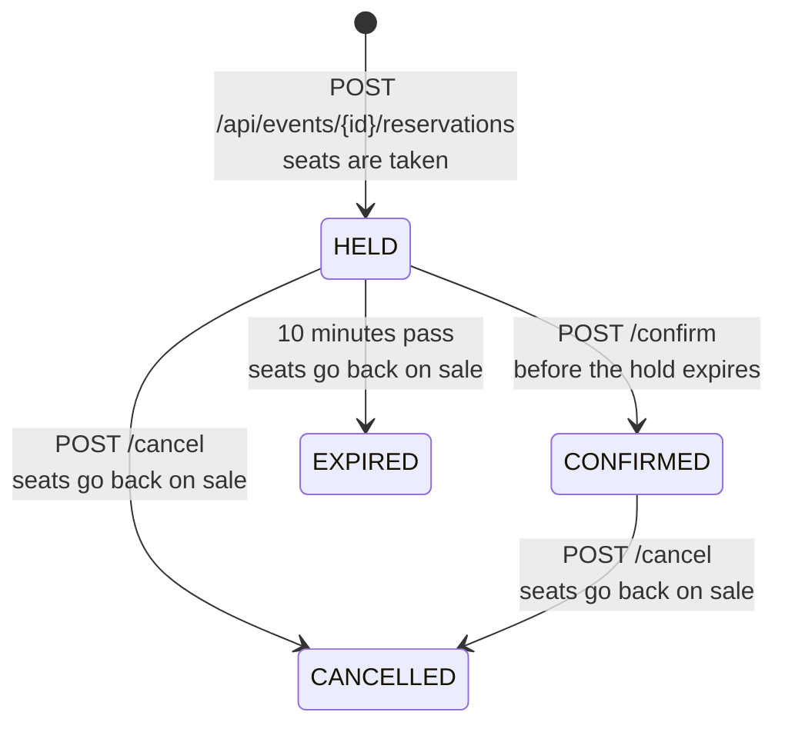

# Ticket Booking API

[](https://github.com/Amandadamata/ticket-booking-api/actions/workflows/ci.yml)


A REST API for event tickets, built with Spring Boot and PostgreSQL. It solves the three problems that make ticket sales hard:

1. **Two people buy the last seat at the same moment.** Only one of them gets it.
2. **Someone holds seats and walks away.** The hold expires after 10 minutes and the seats go back on sale.
3. **The network fails and the app sends the purchase again.** The retry returns the same reservation instead of buying twice.

It's a study project with no real payments, but every rule above is proven by tests against a real PostgreSQL server, including tests that fire 40 requests at the same time.

## How a purchase works



A customer first **holds** seats. In a real shop this is when the payment page opens. The seats are taken right away, so nobody else can buy them while the customer pays. The customer then **confirms** within 10 minutes, or the hold **expires** and a background job releases the seats.

## The three problems, and how they are solved

### 1. Never selling the same seat twice

The obvious code has a race condition:

```java
// Two requests can both read "1 seat left" before either one writes.
if (event.getAvailableSeats() >= quantity) {
    event.setAvailableSeats(event.getAvailableSeats() - quantity);
}
```

Instead, checking and taking seats happen in **one SQL statement**:

```sql
UPDATE events SET available_seats = available_seats - :quantity
WHERE id = :eventId AND available_seats >= :quantity
```

PostgreSQL locks the row while it runs the update, so concurrent requests are applied one after the other, and each one sees the result of the previous. If there aren't enough seats left, no row matches, the method returns `0`, and the API answers `409 Conflict` with how many seats are left. As a last line of defense, the table has `CHECK (available_seats BETWEEN 0 AND capacity)`, so even a bug in the Java code can't push the count below zero.

**Proof:** [`neverSellsMoreSeatsThanExist`](src/test/java/com/amandadamata/ticketing/booking/ReservationServiceTest.java) starts 40 threads that try to buy from an event with 10 seats at the same instant. Exactly 10 succeed, 30 get "not enough seats", and the database ends with 0 seats and 10 reservations.

### 2. Holds that expire

Every hold has an `expiresAt`. A scheduled job ([`HoldExpiryJob`](src/main/java/com/amandadamata/ticketing/booking/HoldExpiryJob.java)) runs every 30 seconds, marks expired holds as `EXPIRED` and gives their seats back. Two details make it safe:

- **Row locks between the job and the customer.** The job reads holds with `SELECT ... FOR UPDATE SKIP LOCKED`, and confirm/cancel lock the reservation with `FOR UPDATE`. A confirmation and the expiry can never both win, and the seats are never released twice.
- **The deadline is checked on every action, not only by the job.** If a customer confirms one second after the deadline, before the job runs, the API expires the hold right there, releases the seats and answers `409 HOLD_EXPIRED`. The answer and the data always agree.

### 3. Retries that don't buy twice

Clients can send an `Idempotency-Key` header, any unique value per purchase attempt:

| Request | Response |
|---|---|
| First request with key `order-7f3a` | `201 Created`, new reservation |
| Same key, same body (a retry) | `200 OK` with `Idempotent-Replayed: true` and the **same** reservation |
| Same key, different body | `422 IDEMPOTENCY_KEY_REUSED` |

The key column has a `UNIQUE` index. If two copies of the request arrive at exactly the same time, only one insert succeeds. The other transaction rolls back, which also gives back the seats it took, and returns the reservation that won. [`retriesArrivingTogetherCreateOnlyOneReservation`](src/test/java/com/amandadamata/ticketing/booking/ReservationServiceTest.java) sends 8 copies at once and checks that there is 1 reservation and only 2 seats taken.

## API

| Method | Path | What it does |
|---|---|---|
| `POST` | `/api/events` | Create an event with a number of seats |
| `GET` | `/api/events?page=0&size=20` | List events, soonest first |
| `GET` | `/api/events/{id}` | One event and its available seats |
| `POST` | `/api/events/{id}/reservations` | Hold seats (optional `Idempotency-Key` header) |
| `GET` | `/api/reservations/{id}` | One reservation |
| `POST` | `/api/reservations/{id}/confirm` | Confirm a hold before it expires |
| `POST` | `/api/reservations/{id}/cancel` | Cancel and release the seats (safe to repeat) |
| `GET` | `/actuator/health` | Health check |

Interactive docs (Swagger UI) are at `/swagger-ui.html` when the app is running.

### Example session

These are real responses from the packaged JAR, against an event with 2 seats:

```console
$ curl -X POST localhost:8080/api/events -H 'Content-Type: application/json' \
    -d '{"name":"Jazz Night","venue":"Blue Room","startsAt":"2026-12-12T21:00:00Z","capacity":2}'
HTTP/1.1 201
Location: /api/events/1
{"id":1,"name":"Jazz Night","venue":"Blue Room","startsAt":"2026-12-12T21:00:00Z","capacity":2,"availableSeats":2}

$ curl -X POST localhost:8080/api/events/1/reservations -H 'Content-Type: application/json' \
    -H 'Idempotency-Key: order-7f3a' -d '{"customerEmail":"ana@example.com","quantity":2}'
{"id":"4cf11635-687b-432f-82c3-df54375e8150","eventId":1,"customerEmail":"ana@example.com","quantity":2,
 "status":"HELD","createdAt":"2026-11-09T13:24:06.511202Z","expiresAt":"2026-11-09T13:34:06.511202Z", ...}

$ # the same request again, as if the response had been lost
HTTP/1.1 200
Idempotent-Replayed: true

$ curl -X POST localhost:8080/api/events/1/reservations -H 'Content-Type: application/json' \
    -d '{"customerEmail":"bruno@example.com","quantity":1}'
{"type":"https://github.com/Amandadamata/ticket-booking-api#not-enough-seats","title":"Not enough seats",
 "status":409,"detail":"You asked for 1 seat(s), but only 0 are left.","code":"NOT_ENOUGH_SEATS",
 "availableSeats":0,"eventId":1,"requested":1,"instance":"/api/events/1/reservations"}
```

### Errors

Every error follows [RFC 9457](https://www.rfc-editor.org/rfc/rfc9457) (`application/problem+json`), with a stable `code` so clients never have to parse messages:

| Status | `code` | When |
|---|---|---|
| 400 | `VALIDATION_FAILED` | Missing or invalid fields; `fields` lists **every** problem, not just the first |
| 404 | `EVENT_NOT_FOUND`, `RESERVATION_NOT_FOUND` | Unknown id |
| 409 | `NOT_ENOUGH_SEATS` | Includes `availableSeats` |
| 409 | `SALES_CLOSED` | The event has already started |
| 409 | `HOLD_EXPIRED` | Confirmed too late; the seats were released |
| 409 | `INVALID_RESERVATION_STATE` | For example, confirming a cancelled reservation |
| 422 | `EVENT_IN_THE_PAST`, `IDEMPOTENCY_KEY_REUSED` | The request is well formed but breaks a rule |

## Running it

**With Docker** (API + PostgreSQL):

```bash
docker compose up --build
```

The API is then at `http://localhost:8080` and the docs at `http://localhost:8080/swagger-ui.html`.

**Without Docker**, with Java 25 and a PostgreSQL you already have:

```bash
DATABASE_URL=jdbc:postgresql://localhost:5432/tickets DATABASE_USERNAME=tickets DATABASE_PASSWORD=tickets ./mvnw spring-boot:run
```

Flyway creates the tables on startup. Settings such as `booking.hold-duration` (default `PT10M`) are in [`application.yml`](src/main/resources/application.yml).

## Tests

```bash
./mvnw verify
```

33 tests, and none of them needs Docker or an installed database: the integration tests start a **real PostgreSQL 18** from embedded binaries ([zonky embedded-postgres](https://github.com/zonkyio/embedded-postgres)), and Flyway applies the same migrations used in production. The same command runs on a laptop and in [CI](.github/workflows/ci.yml).

| Class | Kind | What it proves |
|---|---|---|
| [`ReservationTest`](src/test/java/com/amandadamata/ticketing/booking/ReservationTest.java) | unit | The state rules without Spring: deadlines, which transitions are allowed, cancelling twice is safe |
| [`ReservationServiceTest`](src/test/java/com/amandadamata/ticketing/booking/ReservationServiceTest.java) | integration | 40 concurrent buyers for 10 seats; 8 simultaneous retries; expiry job; a confirmation racing the job; database constraints |
| [`BookingApiTest`](src/test/java/com/amandadamata/ticketing/api/BookingApiTest.java) | HTTP | Status codes, `Location` and `Idempotent-Replayed` headers, problem details, validation, health and OpenAPI |

Time never comes from the system clock in the code: services receive a `java.time.Clock`. The tests use a clock that only moves when they say so, so "10 minutes later" takes no time at all and gives the same result every run.

CI also builds the Docker image, starts it with PostgreSQL through Compose and waits for `/actuator/health`.

## Design decisions

- **Conditional `UPDATE` instead of optimistic locking (`@Version`).** With `@Version`, popular events would make many requests fail and retry. The conditional update never needs a retry: each request either gets its seats or learns there aren't enough.
- **Seats as a counter, not one row per seat.** This is general admission. Numbered seats would need one row per seat and a different locking strategy; that's listed below as a next step.
- **`TransactionTemplate` instead of `@Transactional` in the booking service.** When a duplicate Idempotency-Key makes a transaction fail, the service has to start a **new** transaction to read the winning reservation. That's explicit with a template and hard to see with annotations.
- **The database guards the rules too.** `CHECK` constraints on seats, quantity and status, a `UNIQUE` index on the key, and a partial index for the expiry job (`WHERE status = 'HELD'`). `spring.jpa.hibernate.ddl-auto=validate` makes the app refuse to start if the entities and the migrations disagree.
- **Layered by feature.** `event`, `booking` and `api` packages. The entities have no setters: state only changes through methods that check the rules, such as `Reservation.confirm(now)`.

## What it doesn't do yet

- No authentication: anyone with a reservation id can confirm or cancel it. Next step: Spring Security with JWT, and customers who only see their own reservations.
- No payments. Confirming stands in for a successful payment.
- No numbered seats, waiting list or rate limiting.
- The expiry job assumes a single instance. With several instances, `SKIP LOCKED` already prevents double processing, but a scheduler lock (such as ShedLock) would avoid wasted runs.

## Tech stack

Java 25 · Spring Boot 4.1 (Web MVC, Data JPA, Validation, Actuator) · PostgreSQL 18 · Flyway · springdoc-openapi · JUnit 6, MockMvc, AssertJ · embedded PostgreSQL for tests · Docker and Docker Compose · GitHub Actions · a Render Blueprint ([`render.yaml`](render.yaml)) for deployment.

## Author

**Amanda da Mata** · Back-end developer · Java and Python
[LinkedIn](https://www.linkedin.com/in/amanda-da-mata-492106288) · [GitHub](https://github.com/Amandadamata)

Built with help from AI coding assistants. The rules, decisions and trade-offs are all documented above and covered by the tests. MIT [license](LICENSE).
